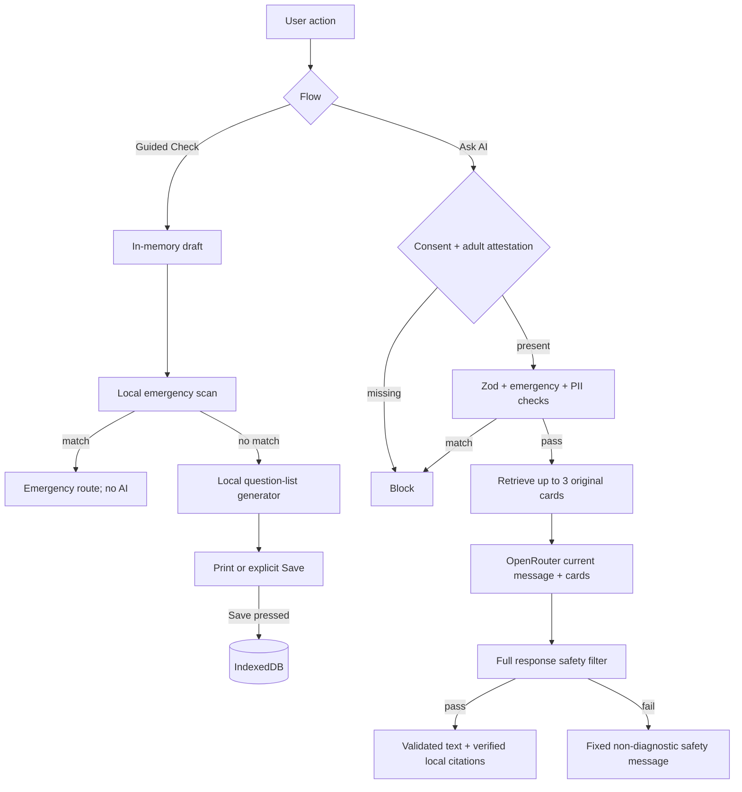

# Clinora AI — Architecture

## System overview

Clinora AI is a Next.js App Router application with server-rendered public/educational pages and client components only where browser state is needed. Guided Check and its summary are deterministic and local. The only optional external data path is the current chat message plus bounded original retrieval context sent from a Next.js route handler to OpenRouter after user action and safety checks.

There is no database service, authentication, account, cloud profile, analytics, advertising, EHR integration, local model, mock provider, or demo mode.

## System architecture

```mermaid
flowchart LR
  U[Adult user's browser] --> UI[Next.js React UI]
  UI --> MEM[In-memory Guided Check draft]
  UI --> LS[localStorage: consent and UI settings only]
  UI --> IDB[(IndexedDB: explicitly saved summaries only)]
  UI --> KB[Original local knowledge cards]
  UI --> SR[Deterministic safety and PII guards]
  SR -->|emergency| E[/emergency route]
  SR -->|safe chat request| API[Next.js /api/chat route handler]
  API --> V[Zod validation and repeated guards]
  V --> R[Bounded local retrieval]
  R --> AI[Server-side OpenRouter client]
  AI --> OR[OpenRouter: developer-configured free model]
  OR --> OUT[Complete-output safety validation]
  OUT -->|safe only| STREAM[Validated NDJSON stream]
  OUT -->|unsafe| BLOCK[Fixed safety-boundary response]
  STREAM --> UI
  BLOCK --> UI
```

## Data-flow diagram



## Route map

| Route | Purpose | Data sensitivity |
|---|---|---|
| `/` | Landing and first-use consent handoff | Public |
| `/consent` | Education consent and adult gate | Local consent only |
| `/dashboard` | Post-consent local launchpad | In-memory state |
| `/check` | Guided Check introduction | Public introduction; flow gated |
| `/check/concern` | Own-words concern | Memory only |
| `/check/body-area` | General body area/topic | Memory only |
| `/check/timeline` | Onset and change | Memory only |
| `/check/severity` | Plain-language severity | Memory only |
| `/check/context` | Optional context | Memory only |
| `/check/questions` | Worries and desired questions | Memory only |
| `/check/review` | Review and final local safety scan | Memory only |
| `/summary` | Local Clinician Question List | Memory until explicit save |
| `/assistant` | Ask Clinora AI | Current message leaves only after action |
| `/history` | Saved local entries and deletion | IndexedDB only |
| `/learn`, `/learn/[slug]` | Original educational articles | Public |
| `/emergency` | Always-available emergency/crisis guidance | No health details required |
| `/settings` | Local number, theme, contrast, data deletion | Non-sensitive local settings |
| `/more` | More navigation | Public |
| `/about` | Scope and limitations | Public |
| `/legal` and nine child pages | Student-project legal templates | Public |
| `/api/chat` | Guarded server proxy | No content logging |
| `/api/chat/status` | Boolean availability only | Never exposes model/key |

## OpenRouter request flow

1. Browser consent gate and editable message field.
2. Client emergency and PII pre-checks for fast feedback.
3. Server first requires `consentConfirmed: true` and `adultConfirmed: true`, then applies the strict Zod message schema. This is attestation, not identity verification.
4. Server repeats emergency and PII checks; either blocks before provider access.
5. Missing `OPENROUTER_API_KEY` or `OPENROUTER_MODEL` returns unavailable.
6. Local retrieval selects at most three bounded, instruction-safe original cards.
7. Server instructions and current message/reference data are sent with a 30-second timeout. No prior turns, identity, saved summaries, or draft are attached.
8. Upstream SSE deltas are accumulated without reaching the browser.
9. The complete answer must pass output, citation, emergency, and size checks.
10. Safe text is sent as NDJSON metadata/deltas; unsafe text becomes the fixed safety-boundary response. Provider failure becomes an unavailable response, never a substitute answer.

## Emergency routing flow

```mermaid
flowchart TD
  T[Current free text] --> N[Normalize case and whitespace]
  N --> R[Ordered deterministic rule categories]
  R -->|self-harm/immediate danger| C[Crisis rule event]
  R -->|physical emergency examples| W[Emergency rule event]
  C --> E[Store non-secret category labels in memory]
  W --> E
  E --> G[/emergency]
  G --> Z[No OpenRouter request]
  R -->|no match| OK[Continue; not an emergency assessment]
```

The model is never asked to make this decision. Rule matches are examples, not a complete assessment. The server repeats the check because browser checks can be bypassed.

## RAG retrieval flow

- `data/knowledge/entries.json`: original summaries written for Clinora AI.
- `data/knowledge/sources.json`: independently stored organization/URL metadata.
- Tokenization, term-frequency scoring, title/category weighting, and a small score threshold select at most three cards.
- Entries containing instruction-like prompt-injection phrases, URLs, excessive length, or invalid source references are excluded.
- The model receives IDs/titles/summaries as untrusted reference data, not source URLs or instructions.
- Model-provided URLs are rejected. The server appends links only after matching card/source IDs against local metadata and requiring HTTPS.
- UI labels these “Related resources supplied to Clinora AI” and states they do not validate AI output.

## Browser storage model

| Store | Contents | When written | Cleared by Delete All |
|---|---|---|---|
| React memory | Guided Check draft, unsaved chat, safety event labels | During current session | Yes/reset on reload |
| `localStorage` | `clinora.consent.v1`, `clinora.settings.v1` | Explicit consent/settings action | Yes |
| IndexedDB `clinora-local-history` | Explicitly saved summaries | Save button only | Yes; database deleted |
| `sessionStorage` | No application health content; cleared defensively | Not used by design | Yes |
| Cache Storage | No application runtime cache; Clinora-prefixed caches cleared where feasible | Not used by design | Best effort |

Health content is never written to localStorage. Browser storage is origin- and device-bound, not encrypted application storage, and may be accessible to other users of the same browser profile.

## Security model

- Server-only OpenRouter key; no `NEXT_PUBLIC_` prefix and no key status detail.
- Strict input sizes/types, no arbitrary roles, model names, URLs, or message history accepted from clients.
- Plain React text rendering; no model-generated HTML/Markdown rendering.
- No tools, function calling, file upload, EHR, or privileged model actions.
- Security headers include CSP, frame denial, no-sniff, referrer and permissions restrictions. Development CSP allows required Next.js development behavior.
- No application logging of health prompts, model answers, retrieved text, API keys, or provider error bodies.
- Generic provider errors prevent accidental secret/content leakage.
- Tests use loopback-only provider fixtures and obvious non-secret values, isolated under `e2e/`.

## Threat model

| Threat | Control | Remaining exposure |
|---|---|---|
| Key theft through browser bundle | Server-only import/environment; boolean status endpoint | Deployment/server compromise outside app scope |
| Direct API abuse | Strict schema, bounded input, safety checks, timeout | Public endpoint has no accounts; deployment rate limiting recommended |
| Prompt injection | Bounded original retrieval, data separation, no tools, output filter | Novel/obfuscated injections may evade controls |
| XSS through model/user content | React escaped text, no dangerous HTML, CSP | Dependency/browser vulnerabilities |
| SSRF via base URL | Base URL is developer-only configuration; never accepted from request | Misconfigured deployment can redirect credentials; use default OpenRouter URL |
| Sensitive logs | No application content/error-body logging | Hosting/platform network logs must be reviewed separately |
| Shared-device data access | Opt-in local save and deletion controls | No user authentication or at-rest application encryption |
| Citation spoofing | Ignore model citations; local metadata only | External sites can change after review |

## Deployment model

- Node.js 22.12+ runtime supporting Next.js Route Handlers; static hosting alone is insufficient for chat.
- `OPENROUTER_API_KEY`, `OPENROUTER_MODEL`, and optional `OPENROUTER_BASE_URL` are server environment variables.
- `NEXT_PUBLIC_APP_NAME` and `NEXT_PUBLIC_DEFAULT_EMERGENCY_NUMBER` are non-secret build-time public settings.
- Choose a model currently marked free in OpenRouter's model catalog; do not assume an old free identifier remains available.
- Configure platform log retention and network controls separately. Clinora AI does not claim HIPAA compliance or a regulated deployment posture.

## Failure behavior

| Failure | User-visible behavior | Provider behavior |
|---|---|---|
| AI key/model missing | Submit disabled; transparent unavailable card | No request |
| Timeout/network/provider error | AI temporarily unavailable; Guided Check link | No retry with fallback content |
| Empty/malformed provider answer | Unavailable message | No simulated answer |
| Unsafe answer | Fixed safety-boundary message | Answer discarded |
| Emergency input/output | Emergency redirect/instruction | Request blocked before provider for input |
| PII input | Edit request; original draft preserved | No request |
| IndexedDB unavailable | Save/history error explained; print remains | No server fallback |
| Draft reload | Polite restart prompt | No hidden persistence |
